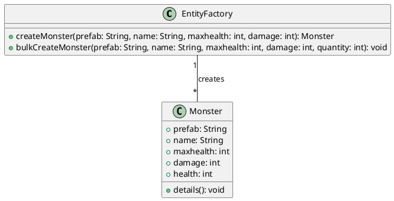
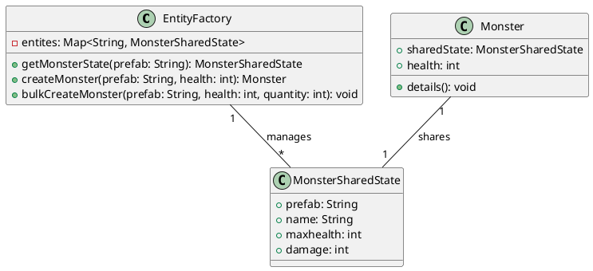

## Motivação

No desenvolvimento de jogos, a criação de múltiplas instâncias de entidades (como inimigos, NPCs ou objetos reutilizáveis) pode gerar problemas de desempenho e consumo excessivo de memória. Criar cada entidade separadamente resulta em alocações desnecessárias, tornando o código ineficiente e difícil de manter. Além disso, a falta de um mecanismo estruturado para gerenciar essas instâncias pode dificultar a escalabilidade do sistema.

Imagine que estamos desenvolvendo um jogo onde vários monstros do tipo aranha precisam ser criados dinamicamente. Em uma abordagem tradicional, cada instância de aranha ocuparia memória individualmente, tornando o sistema ineficiente à medida que mais instâncias fossem adicionadas.



Com o Flyweight Pattern, podemos otimizar essa criação compartilhando o estado intrínseco entre todas as instâncias de um mesmo tipo de aranha. Isso significa que informações como nome, vida máxima e dano serão armazenadas uma única vez e reutilizadas por todas as instâncias, enquanto o estado extrínseco, como a vida atual, será mantido separadamente em cada objeto.




Essa abordagem reduz significativamente o consumo de memória e melhora a eficiência do sistema, garantindo que múltiplas instâncias possam coexistir sem desperdício de recursos.

## Estrutura 


## Solução

A implementação do **Factory Method Pattern** em conjunto com o **Flyweight Pattern** resolve esses problemas, proporcionando:

- **Reutilização de Objetos**: O código reutiliza entidades com base no identificador *prefab*, evitando alocações desnecessárias.
- **Facilidade de Manutenção**: Toda a lógica de criação de entidades fica centralizada na `EntityFactory`, tornando modificações futuras mais fáceis.
- **Escalabilidade**: Com o método `bulkCreateMonster`, múltiplas entidades podem ser criadas dinamicamente sem precisar instanciar cada uma manualmente.

## Participantes

- **Flyweight (Monster)**: Declara uma interface através da qual os flyweights podem receber e atuar sobre estados extrínsecos.
- **ConcreteFlyweight (MonsterSharedState)**: Implementa a interface de Flyweight e armazena estados intrínsecos, tornando o objeto compartilhável.
- **UnsharedConcreteFlyweight (Monster)**: Mantém o estado extrínseco que varia entre as instâncias.
- **FlyweightFactory (EntityFactory)**: 
  - Cria e gerencia objetos flyweight.
  - Garante que os flyweights sejam compartilhados apropriadamente, fornecendo uma instância existente ou criando uma nova quando necessário.
- **Client**: 
  - Mantém uma referência para os flyweights criados.
  - Computa ou armazena o estado extrínseco das entidades.


## Implementação

```js
class EntityFactory {
    constructor() {
        this.entities = {};
    }

    getMonsterState(prefab) {
        if (!this.entities[prefab]) {
            console.log(`[Log] New Shared State Registered: ${prefab}`);
            this.entities[prefab] = MonsterSharedState.create(prefab);
        }
        return this.entities[prefab];
    }

    createMonster(prefab, health) {
        const sharedState = this.getMonsterState(prefab);
        console.log(`[Log] Instantiating New Entity: ${prefab}`);
        return new Monster(sharedState, health);
    }

    bulkCreateMonster(prefab, health, quantity) {
        const monsters = [];
        for (let i = 0; i < quantity; i++) {
            monsters.push(this.createMonster(prefab, health));
        }
        return monsters;
    }
}

class MonsterSharedState {
    constructor(prefab, name, maxhealth, damage) {
        this.prefab = prefab;
        this.name = name;
        this.maxhealth = maxhealth;
        this.damage = damage;
    }

    static create(prefab) {
        const monsterTypes = {
            spider: new MonsterSharedState("spider", "Spider", 100, 20),
            spider_warrior: new MonsterSharedState("spider_warrior", "Spider Warrior", 200, 40),
            spider_hider: new MonsterSharedState("spider_hider", "Cave Spider", 600, 20)
        };
        return monsterTypes[prefab];
    }
}

class Monster {
    constructor(sharedState, health) {
        this.sharedState = sharedState;
        this.health = health;
    }

    details() {
        console.log(`[Log] ${this.sharedState.prefab} information:\nname: ${this.sharedState.name}\nhealth: ${this.health}\ndamage: ${this.sharedState.damage}`);
    }
}

const entityFactory = new EntityFactory();

const spiders = entityFactory.bulkCreateMonster("spider", 80, 6);
const spiderWarrior = entityFactory.createMonster("spider_warrior", 180);
const spiderHider = entityFactory.createMonster("spider_hider", 500);

spiders.forEach(spider => spider.details());
spiderWarrior.details();
spiderHider.details();
```

